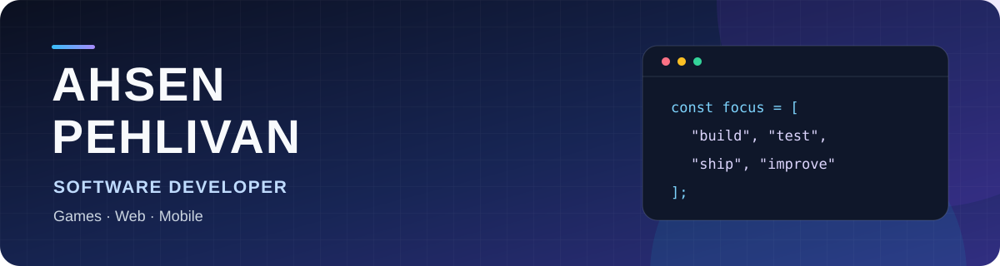

  

  
<strong>Unity & C# · Full-stack Web · Native Android</strong>

  
Building useful products and playable experiences, from the first prototype to release.

  

    
    
  

## 👋 About me

I'm a Computer Engineering student at **Muğla Sıtkı Koçman University** (expected graduation: 2027) and a developer working across games, web products, and Android apps. I enjoy turning ideas into working systems, then refining them through testing and feedback.

## 🎮 Published games

<table>
  <tr>
    <td width="50%" valign="top">
      <h3>🍽️ Sunberry Order</h3>
      
A 3D restaurant game where players serve customers, earn money, and grow their restaurant.

      
<a href="https://play.google.com/store/apps/details?id=com.sunberry.order"><strong>Play on Google Play ↗</strong></a>

    </td>
    <td width="50%" valign="top">
      <h3>🌱 Farm Sunberry</h3>
      
A Unity/C# farming game. As the main developer in a two-person team, I built gameplay, inventory, progression, and economy systems, plus cloud-backed player services with Unity Gaming Services.

      
<a href="https://play.google.com/store/apps/details?id=com.sunberry.farm"><strong>Play on Google Play ↗</strong></a> · <a href="https://github.com/ahsenpehlivan/SunberryFarm">Code showcase ↗</a>

    </td>
  </tr>
</table>

The Farm Sunberry repository is a technical showcase and does not contain the full production project.

## 🚀 Selected projects

- **[Notsen](https://github.com/ahsenpehlivan/Notsen)** — Kanban and quick-notes product built with **Next.js, React, TypeScript, Supabase, and PostgreSQL**. The repository also includes a **Kotlin and Jetpack Compose** Android client.
- **[Tepebaşı BT Destek](https://github.com/ahsenpehlivan/TepebasiBTDestek)** — IT support and device-inventory MVP developed during my internship at Tepebaşı Municipality. Includes a **Next.js** web panel and **Kotlin/Jetpack Compose** Android foundation, with **Supabase Auth, PostgreSQL, and row-level security**.
- **[Yağmur Rotası](https://github.com/ahsenpehlivan/YagmurRotasi2D)** — **Unity/C# WebGL** water-conservation puzzle game developed for Tepebaşı Municipality. Features a 100-level campaign, puzzle validation tools, progression, and browser-local saves.
- **[F1 Predictive Modeling](https://github.com/ahsenpehlivan/Applied-Machine-Learning-Project)** — Collaborative **Python** project for feature engineering, podium classification, fastest-lap regression, and a **Streamlit** demo.

## 🛠️ Toolkit

  
  
  
  
  
  
  
  

**Languages:** C#, TypeScript, JavaScript, Kotlin, Python, SQL  
**Web and data:** Next.js, React, Supabase, PostgreSQL, MySQL  
**Game and mobile:** Unity, Unity Gaming Services, Android, Jetpack Compose  
**Development tools:** Git, GitHub Actions, Docker, Linux

I'm interested in software engineering roles involving product development, code quality, and AI-assisted workflows with thoughtful review and testing.

## 📫 Connect

[LinkedIn](https://www.linkedin.com/in/ahsenpehlivan/) · [Email](mailto:ahsenpehlivan007@gmail.com)
